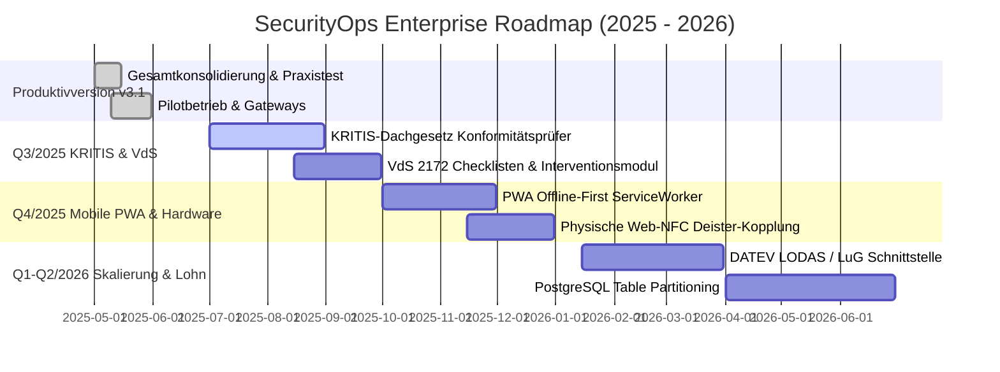

# SECURITYOPS - Strategische Roadmap & Weiterentwicklungsplan (2025 - 2026)

**Projektphase:** DAUERHAFTER BETRIEB & WARTUNGSMODUS (Phase 9 konsolidiert)  
**Architektur:** Modularer Monolith (FastAPI / PostgreSQL 16 / React 19 / Redis 7 / Celery 5.4)

---

## 1. Quartalsübersicht & Meilensteine

---

## 2. Geplante Erweiterungsstufen (ohne Breaking Changes)

1. **KRITIS-Dachgesetz & VdS 2172 (Q3 2025):**
   - Automatische Revisionsberichte für Aufsichtsbehörden bei Vorfällen in kritischen Infrastrukturen.
   - VdS-zertifizierte Interventionsprotokolle mit GPS- und Zeitstempel-Abgleich.
2. **Offline-First PWA (Q4 2025):**
   - Vollständige ServiceWorker IndexedDB-Kopplung für unterirdische Schutzobjekte ohne WLAN/LTE.
3. **DATEV Lohnschnittstelle (Q1 2026):**
   - Direkter Export von genehmigten Arbeitszeitkonten und steuerfreien Zuschlägen (§ 3b EStG) in DATEV LODAS.
